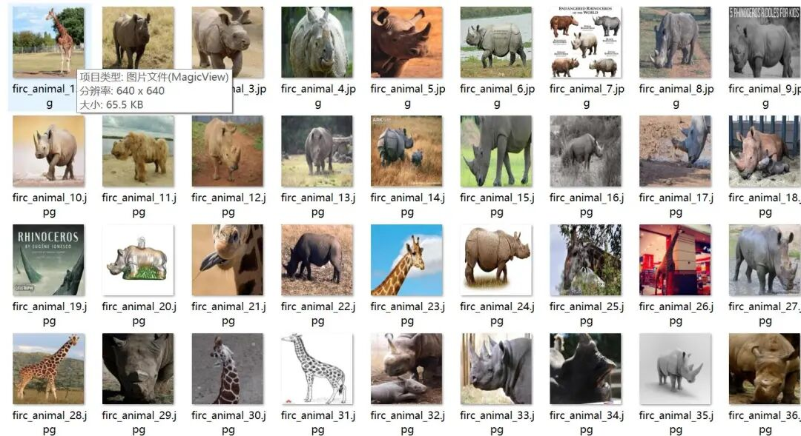
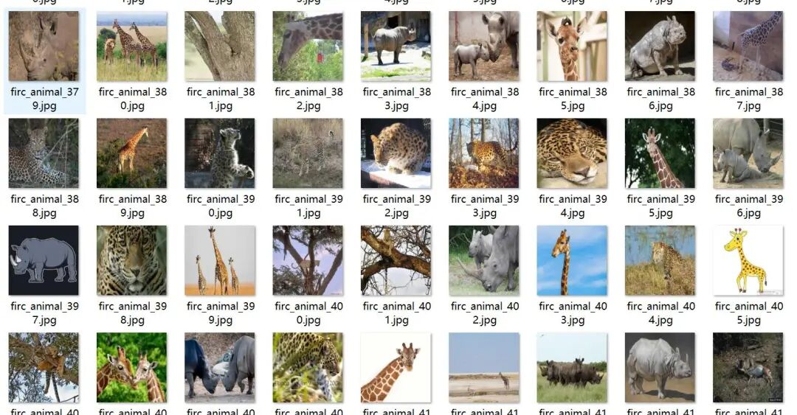
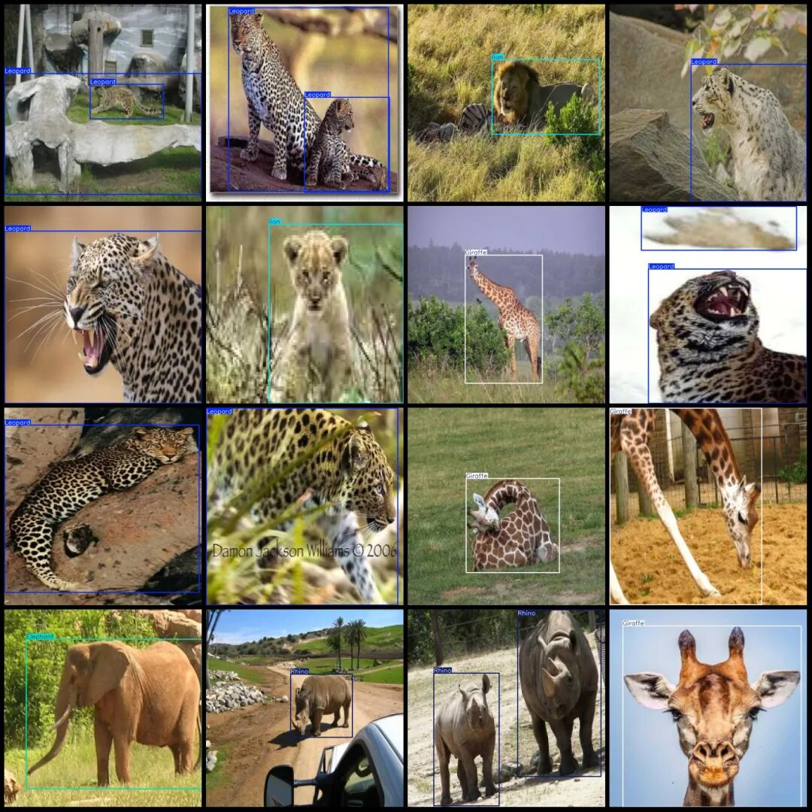
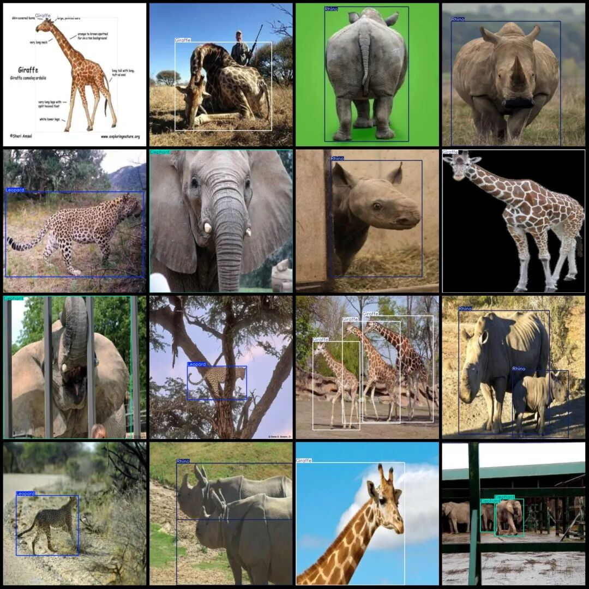

# African Animals Dataset for Detection: VOC+YOLO format with 1418 images in 5 categories

Dataset format: Pascal VOC format + YOLO format (txt file without split path, only containing jpg images and corresponding VOC format xml files and yolo format txt files)

Number of images (number of jpg files): 1418

Number of annotations (number of xml files): 1418

Number of annotations (number of txt files): 1418

Label category count: 5

Label category names (note that the order of yolo format categories does not correspond to this, but is based on the labels folder's classes.txt): ["Elephant", "Giraffe", "Leopard", "Rhino", "lion"]

Number of boxes labeled in each category:

Elephant (elephant) frame count = 418, occupying picture count = 278.

Giraffe (Giraffe) frame count = 330, occupy image count = 254

The number of frames for the Leopard (leopard) is 360, and the number of images occupied is 296.

Rhino (Rhinoceros) frame count = 430, occupying picture count = 296

Lion (lion) frame count = 410, occupy picture count = 294

Total frame count: 1948

Image resolution: 640x640

Using labelImg:

Annotation rules: Draw a rectangle around the category.

Important Notice: The dataset does not have separate training, validation, and test sets; you need to partition them yourself.

Special : This dataset does not guarantee the accuracy of the trained models or weight files.

Image Preview:

Annotation example:

## Payment

Here is a pay link on Stripe ( https://buy.stripe.com/3cs8yP7sY87d0vu9AB ). Please contact me lonlonago@foxmail.com after funding $89, and I will send you a complete data files , thank you!

